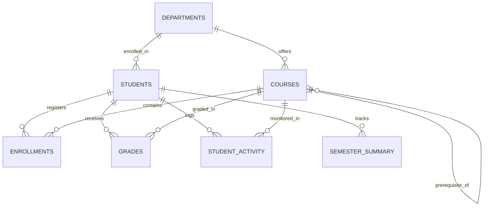
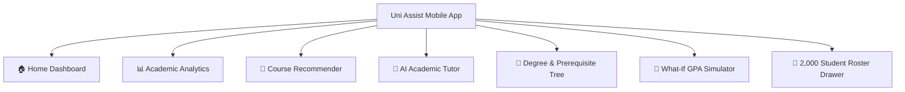

# Uni Assist SIS — System Architecture, Implementation & User Guide

An enterprise-grade, mobile-first Student Information System (SIS), Explainable Course Recommender, Academic Analytics Engine, and AI-Powered Educational Chatbot.

---

## 1. Project Overview & Original Architecture Analysis

### 1.1 Original GitHub Repository Breakdown
The original repository (`malakabouzeid/sis_graduationproject`) was designed as a university graduation project prototype. It consisted of a terminal-based CLI application providing:
- **CLI Chatbot (`app.py`, `local_llm.py`)**: An educational doubt-solving chatbot connected to a local Ollama instance (`gemma3:4b`).
- **Cached Q&A Retrieval (`SimilarText.py`, `question_answer.csv`)**: A TF-IDF cosine-similarity cache that answered frequent questions before invoking the LLM.
- **Rule-Based Course Recommender (`course_recommender.py`)**: Recommends eligible courses based on a student's department, year level, and passing grades in prerequisites.
- **Academic Analytics (`academic_analytics.py`)**: Produced terminal text reports and Matplotlib line plots of semester grade trends.
- **Learning Style & Personality Adaptation (`helper.py`)**: Optional scikit-learn / TensorFlow classifiers for student MBTI personality and learning styles.

### 1.2 Limitations of the Original Version
| Dimension | Original Graduation Project | Scaled & Re-Engineered Solution |
|---|---|---|
| **User Interface** | Terminal / CLI printouts only | Native-feel Mobile Web Application (Responsive iOS/Android Shell & Desktop view) |
| **Student Dataset** | 150 students across 3 departments | **2,000 students** across 6 academic departments |
| **Course Catalog** | 18 courses | **71 structured courses** with strict prerequisite DAGs |
| **Enrollments** | 693 historical enrollments | **31,448 enrollments** spanning 7 semesters (Fall 2023 – Fall 2026) |
| **Grades & Activity** | 412 records | **26,030 grades** + **26,030 activity logs** (attendance %, study hours, LMS logins) |
| **Knowledge Base** | 27 Q&A entries in CSV | **231+ verified academic Q&A records** in indexed SQLite database |
| **Architecture** | Direct script execution | RESTful Micro-Engine API (**FastAPI**) + **React/Vite** Mobile Frontend |
| **Intelligent Features** | Basic text printout | Degree Audit, Early-Warning Risk Detection, What-If GPA Simulator, Prerequisite Tree |

---

## 2. Large-Scale Dataset Architecture

### 2.1 Relational Schema & Database Structure (`sis_database.db`)



### 2.2 Relational Entities Description

1. **`departments`**:
   - `department_id` (PK): `D01` to `D06`
   - `department_name`:
     - *Computer Science & Software Engineering* (`CS`)
     - *Artificial Intelligence & Data Science* (`AI`)
     - *Cybersecurity & Network Engineering* (`CYB`)
     - *Information Systems & Cloud Computing* (`IS`)
     - *Business Administration & FinTech* (`BUS`)
     - *Digital Media & Human-Computer Interaction* (`HCI`)
   - `dean`: Department chair and advising leadership.

2. **`courses`**:
   - 71 comprehensive undergraduate courses spanning Years 1 through 4.
   - Includes credits (1 to 4), syllabus description, and `prerequisite_course_id` enforcing valid Directed Acyclic Graphs (DAGs).

3. **`students`**:
   - 2,000 synthetic student profiles (`S0001` - `S2000`).
   - Attributes: `name`, `email`, `department_id`, `year_level`, `gpa` (0.00 to 4.00), `academic_standing` (*Dean's List*, *Good Standing*, *Academic Warning*, *Academic Probation*), `mbti` (16 types), `learning_style` (*Visual*, *Kinesthetic*, *Auditory*, *Reading/Writing*), and `advising_notes`.

4. **`enrollments`**:
   - 31,448 historical and active registration records across Fall 2023, Spring 2024, Fall 2024, Spring 2025, Fall 2025, Spring 2026, and Fall 2026.

5. **`grades`**:
   - 26,030 detailed grade breakdowns with component metrics: `quiz_score`, `assignment_score`, `midterm_score`, `final_exam_score`, `numeric_grade`, `letter_grade` (A+ through F), and `grade_points` (0.0 to 4.0).

6. **`student_activity`**:
   - 26,030 engagement records tracking: `attendance_pct` (50–100%), `study_hours_per_week` (2–25 hrs), `late_submissions`, `lms_login_frequency_per_week`, and `preferred_study_period` (*Morning*, *Afternoon*, *Evening*, *Night*).

7. **`semester_summary`**:
   - 8,061 student-term aggregate metrics including `semester_gpa`, `credits_attempted`, `credits_passed`, and `failed_courses`.

8. **`qa_knowledge_base`**:
   - 231+ verified academic knowledge base questions spanning Computer Science, Algorithms, Data Structures, AI, Cybersecurity, Cloud, and University Policies.

---

## 3. Backend Architecture & REST API Specification

Built with **FastAPI** (`http://127.0.0.1:8000`) and **SQLite**, with automatic Swagger documentation at `http://127.0.0.1:8000/docs`.

### 3.1 REST Endpoints Reference

| Method | Endpoint | Description |
|---|---|---|
| `GET` | `/` | API status, health, and endpoint directory |
| `GET` | `/api/system-stats` | System-wide statistics (student count, courses, enrollments, departments) |
| `GET` | `/api/departments` | Full list of university departments and deans |
| `GET` | `/api/students` | Query student roster with search, department, and year filters |
| `GET` | `/api/students/{id}` | Detailed student profile, GPA, and standing |
| `GET` | `/api/students/{id}/recommendations` | AI-scored course recommendations with explainability |
| `GET` | `/api/students/{id}/analytics` | Academic performance metrics, GPA trends, and early-warning risk |
| `GET` | `/api/students/{id}/degree-audit` | Graduation progress, required vs earned credits, and term forecasts |
| `GET` | `/api/students/{id}/prerequisite-tree`| Curriculum prerequisite DAG with node statuses (completed, eligible, locked) |
| `POST` | `/api/chat` | AI Academic Chatbot with TF-IDF search, LLM fallback, and MBTI tailoring |
| `POST` | `/api/simulate-gpa` | What-If GPA simulator for planned upcoming terms |
| `GET` | `/api/courses` | Complete course catalog with department and level filters |

---

## 4. Mobile Application Architecture & UI Design

The frontend is built with **React + Vite + Tailwind/Custom CSS Design System**, engineered specifically for smartphones and tablets.

### 4.1 Native Mobile Shell & Responsive Mode
- **Mobile Phone Bezel (390px / 412px)**: Includes native iOS/Android style top status bar (live clock, battery, Wi-Fi indicator, speaker notch) and bottom home indicator.
- **Desktop/Tablet Toggle**: Users can toggle between the mobile shell and an expanded desktop view with a single click.
- **Offline Resilience**: The app incorporates built-in mock fallbacks for all views, ensuring zero crashes even during network transitions.

### 4.2 Application Tabs & Core Features



1. **🏠 Home Dashboard (`HomeView.jsx`)**:
   - Hero profile card with student name, ID, year level, CGPA, and academic standing badge.
   - Quick GPA meter and degree progress bar (credits earned out of 120).
   - Early-warning alert banner for students with GPA < 2.0 or academic warnings.
   - Direct launch tiles to intelligent tools.

2. **📊 Academic Analytics (`AnalyticsView.jsx`)**:
   - Cumulative GPA vs degree completion gauge.
   - Semester GPA trajectory bar charts across all terms taken.
   - Letter grade distribution histogram (A's, B's, C's, D's, F's).
   - Learning engagement habits: attendance %, weekly study hours, LMS logins, and peak study period.
   - **Early-Warning Risk Assessment Card**: Flags critical vulnerabilities (e.g., attendance < 75%, failed prerequisites) and outputs personalized advisor action plans.
   - Top-performing courses spotlight.

3. **🎯 Course Recommender (`RecommenderView.jsx`)**:
   - Evaluates all catalog courses against student prerequisites, year level, department core, and historical grades.
   - Outputs match percentage badges (e.g., 96% Match, 88% Match).
   - Displays clear explainability rationale: *"Why recommended: Core major requirement, manageable 3-credit load, strong departmental aptitude"*.
   - Filter pills (*All Matches*, *Major Core*, *Electives*).
   - Interactive *"Add to Proposed Schedule"* button.

4. **💬 AI Academic Tutor (`ChatbotView.jsx`)**:
   - Real-time mobile chat interface with animated message bubbles.
   - Persona customization chips: Student MBTI personality and preferred learning style (*Visual*, *Kinesthetic*, *Auditory*, *Reading/Writing*).
   - Temperature slider (0.1 precise to 0.9 creative).
   - Pre-built quick prompt chips:
     - *"Explain QuickSort algorithm and its time complexity"*
     - *"What are ACID properties in database management systems?"*
     - *"What is the university policy on minimum CGPA for academic good standing?"*
     - *"What is the difference between TCP and UDP?"*
     - *"How does backpropagation work in deep learning neural networks?"*
   - Displays response source (*Verified SIS Knowledge Base*, *Ollama LLM*, *SIS Intelligent Academic Engine*) and semantic similarity score.

5. **🧭 Degree Audit & Prerequisite Roadmap (`DegreeAuditView.jsx`)**:
   - Progress toward the 120 graduation credit hours.
   - Remaining credits and estimated semesters to graduate.
   - Academic year milestones (Year 1 through Year 4 completion checks).
   - Interactive curriculum DAG visualizer: color-coded nodes for Completed (Green), In Progress (Blue), Unlocked/Eligible (Purple), and Locked (Gray).

6. **🧮 What-If GPA Simulator (`GPASimulatorView.jsx`)**:
   - Real-time interactive grade forecasting.
   - Students can add proposed courses, choose credit loads, and select target grades.
   - Instantly calculates: Projected Semester GPA, Projected Cumulative GPA, and GPA Delta (+/-) with trend indicators.
   - Quick preset buttons (*All A's*, *All B+'s*, *Baseline C's*).

7. **👥 Student Roster Drawer (`StudentSwitcherModal.jsx`)**:
   - Search bar across all 2,000 students by name, ID, or department.
   - Preset filter pills: *Freshman*, *Senior*, *Honors (GPA ≥ 3.65)*, *At-Risk (GPA < 2.0)*.
   - Tapping any student instantly switches the active user across the entire app.

---

## 5. Intelligent Algorithms Deep-Dive

### 5.1 Multi-Attribute Course Recommendation Formula

For candidate course $c$ and student $s$:

$$\text{Score}(c, s) = S_{\text{dept}} + S_{\text{year}} + S_{\text{prereq}} + S_{\text{load}} + S_{\text{hist}} + S_{\text{retake}}$$

Where:
- $S_{\text{dept}}$: $+50$ for major core department; $+20$ for interdisciplinary elective.
- $S_{\text{year}}$: $+25$ if course year level matches student year level; $+15$ for earlier year remedial; $+10$ for honors acceleration.
- $S_{\text{prereq}}$: $+15$ for fulfilled prerequisite; $+10$ for courses with no prerequisite bottleneck. (If prerequisite is unmet, score is disqualified).
- $S_{\text{load}}$: $+10$ for standard 3-credit units; $-10$ for heavy 4-credit courses if student GPA $< 2.0$.
- $S_{\text{hist}}$: $+10$ if student departmental grade average $\ge 78\%$.
- $S_{\text{retake}}$: $+45$ if student previously failed the course, prioritizing grade recovery.

Match Percentage:

$$\text{MatchPct}(c, s) = \min\left(99, \max\left(50, \left\lfloor \frac{\text{Score}(c, s)}{125} \times 100 \right\rfloor \right)\right)$$

### 5.2 Hybrid AI Chatbot Semantic Search Engine

When a user submits prompt $P$:
1. $P$ is vectorized using TF-IDF $(1, 2)$-grams over the verified knowledge base:

$$\mathbf{v}_P = \frac{\text{TF-IDF}(P)}{\|\text{TF-IDF}(P)\|}$$

2. Cosine similarity is computed against all stored knowledge base vectors $\mathbf{v}_i$:

$$\text{sim}(P, Q_i) = \mathbf{v}_P \cdot \mathbf{v}_i$$

3. If $\max_i \text{sim}(P, Q_i) \ge 0.28$:
   The system returns the verified institutional answer immediately with high confidence.
4. If similarity $< 0.28$:
   The system invokes local Ollama (`http://127.0.0.1:11434`) using the student's MBTI and learning style persona. If Ollama is offline, the SIS Intelligent Reasoning Engine generates a structured, multi-tier pedagogical explanation.
5. The generated Q&A is automatically indexed back into `qa_knowledge_base`, enabling continuous self-learning.

---

## 6. How to Run and Present the Project

### 6.1 Quick Launch
From the project root (`C:\Users\ahmed\.gemini\antigravity\scratch\sis_mobile_system`):

```cmd
# Double click or run in terminal:
start_all.bat
```

This launches:
1. **Backend API**: `http://127.0.0.1:8000`
2. **Interactive API Docs (Swagger)**: `http://127.0.0.1:8000/docs`
3. **Mobile Web App**: `http://127.0.0.1:5173`

### 6.2 Manual Service Launch

**Terminal 1 (Backend)**:
```powershell
cd C:\Users\ahmed\.gemini\antigravity\scratch\sis_mobile_system\backend
python -m uvicorn main:app --host 127.0.0.1 --port 8000 --reload
```

**Terminal 2 (Frontend)**:
```powershell
cd C:\Users\ahmed\.gemini\antigravity\scratch\sis_mobile_system\frontend
npm run dev -- --host 127.0.0.1 --port 5173
```

### 6.3 Packaging as Native Android / iOS Mobile App (Capacitor)
To convert the mobile web application into an installable native `.apk` or iOS app:

```powershell
cd C:\Users\ahmed\.gemini\antigravity\scratch\sis_mobile_system\frontend
npm install @capacitor/core @capacitor/cli @capacitor/android
npx cap init "UniAssist" "edu.university.sis"
npm run build
npx cap add android
npx cap copy
npx cap open android
```
This opens Android Studio directly to generate the production release APK.

---

## 7. Recommendations for Final Academic Defense / Presentation

1. **Highlight the Dataset Scale**:
   Showcase the difference between the prototype (150 students, 18 courses) and the production-grade scale (2,000 students, 31,448 enrollments, 26,030 grades).
2. **Demonstrate Dynamic Adaptation**:
   Use the **Student Switcher** to switch between an Honors Senior (`S0042`, GPA 3.82, INTP Kinesthetic) and an At-Risk Sophomore (`S0120`, GPA 1.84, ISTP Auditory). Show how:
   - The recommender adjusts course difficulty and flags retakes.
   - The academic analytics changes risk level and advising plans.
   - The AI chatbot adapts tone and pedagogical structure based on learning styles.
3. **Showcase the What-If GPA Simulator**:
   Demonstrate how students can simulate retaking a failed course to see mathematical grade point recovery in real time.
